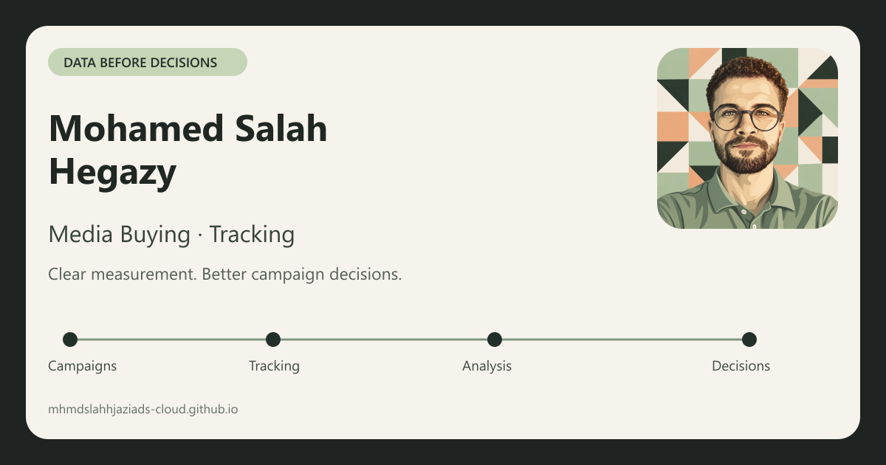

# Mohamed Salah Hegazy

**Media Buying · Tracking · E-commerce**

[العربية — Live portfolio](https://mhmdslahhjaziads-cloud.github.io/) · [English](https://mhmdslahhjaziads-cloud.github.io/en/) · [LinkedIn](https://www.linkedin.com/in/mhmdslahhjazi/)

موقع محمد صلاح حجازي لعرض الخدمات والأدوات والخبرة المهنية، بتجربة عربية وإنجليزية وتواصل برسالة جاهزة. الموقع في مرحلة تجريبية.



## Experience

- Arabic/English entry points, RTL/LTR layouts, saved light/dark preferences and responsive navigation.
- Automatically rotating service tabs, centered Freelance / Part-time availability and animated country flags on interaction.
- Twenty toolkit items, including Microsoft Clarity, in equal panels with two rows of icons.
- Compact career cards with transparent company and freelance logos; centered final card on phones.
- Contextual matte headings, reduced-motion support and a desktop-only beta badge above the portrait.
- Twenty-four tracking brands in three interactive rows, with manual navigation and pause during interaction.
- Validated WhatsApp/email draft preparation: the visitor reviews and sends the message themselves.

## Latest verification

The approved interface is live. Asset/anchor/JavaScript, SEO and CSS-scope checks passed, along with sixteen contact/ruler/letter tests and tracking scheduling, privacy and duplicate-event checks.

PageSpeed Insights on **12 October 2026** measured **87 mobile / 90 desktop** performance. These are single lab results, not a real-user Core Web Vitals certification. Production GA4, Clarity and Meta libraries loaded successfully in the browser.

See [the release verification report](docs/RELEASE-CHECK-2026-10-12.md) for metrics and limitations.

## Project map

| Area | Source |
| --- | --- |
| Content, translations and section structure | `index.html` |
| Generated English page | `en/index.html` |
| CSS sources and current fingerprinted bundle | `assets/css/` |
| Service tabs and contextual motion | `assets/js/hero-tabs.js`, `hero-motion.js` |
| Availability and country interaction | `assets/js/availability.js`, `assets/flags/` |
| Company/platform logos and responsive portrait | `assets/` |
| Contact draft preparation | `assets/js/contact-composer.js` |
| Tracking loaders and first-paint scheduler | `assets/js/google-analytics.js`, `clarity.js`, `meta-pixel.js`, `tracking-schedule.js` |
| Build and verification commands | `scripts/` |
| Deployment, maintenance and release history | `docs/` |

## Local development

The committed site is static and needs no package installation to serve:

```sh
python -m http.server 8080
```

Open `http://localhost:8080/` or `/en/`. Edit Arabic content and its `data-en` translation in `index.html`; regenerate English instead of editing its output directly.

After changing CSS sources, rebuild using Python with `scripts/performance-requirements.txt` installed:

```sh
python scripts/build-performance-css.py
node scripts/build-seo.mjs
```

Keep the five source stylesheets and the one bundle referenced by both HTML entry points. Remove superseded bundles after checking their references.

## Verification

```sh
node scripts/verify-site.mjs
node scripts/test-seo.mjs
python scripts/test-css-scopes.py
node --test scripts/test-contact-composer.mjs scripts/test-letter-train.mjs scripts/test-ruler-layout.mjs
node scripts/test-tracking-schedule.mjs
node scripts/test-tracking-queues.mjs
node scripts/test-brand-stylesheet.mjs
```

Browser checks cover phones, desktop, both themes, language changes and interaction. Automated checks complement visual review.

## Measurement and publishing

GitHub Pages publishes `main` from the repository root. [Deployment](docs/DEPLOYMENT.md), [maintenance](docs/MAINTENANCE.md) and [changelog](docs/CHANGELOG.md) describe the workflow.

GA4 `G-5E9BPGNJJH`, Clarity `yvk9p3430s` and Meta Pixel `1166315572519798` load only on the production hostname. Local previews stay out of production reports. Contact fields are masked for Clarity; outgoing analytics classifications exclude draft text and the project URL.

The `contact` event measures prepared-contact intent, not a sent message or sale. Dashboard configuration and event receipt require separate provider-account verification. See the [UTM and measurement guide](docs/UTM-and-measurement.html).

## Ownership and credits

Portfolio content, portrait and CV belong to Mohamed Salah Hegazy; no open-source license is granted for the portfolio itself. Brand marks belong to their respective owners. Font/icon notices remain in [OFL.txt](assets/fonts/OFL.txt) and [brand-icons-LICENSE.txt](assets/brand-icons-LICENSE.txt). New artwork provenance is recorded in [ASSET-SOURCES.md](docs/ASSET-SOURCES.md).
